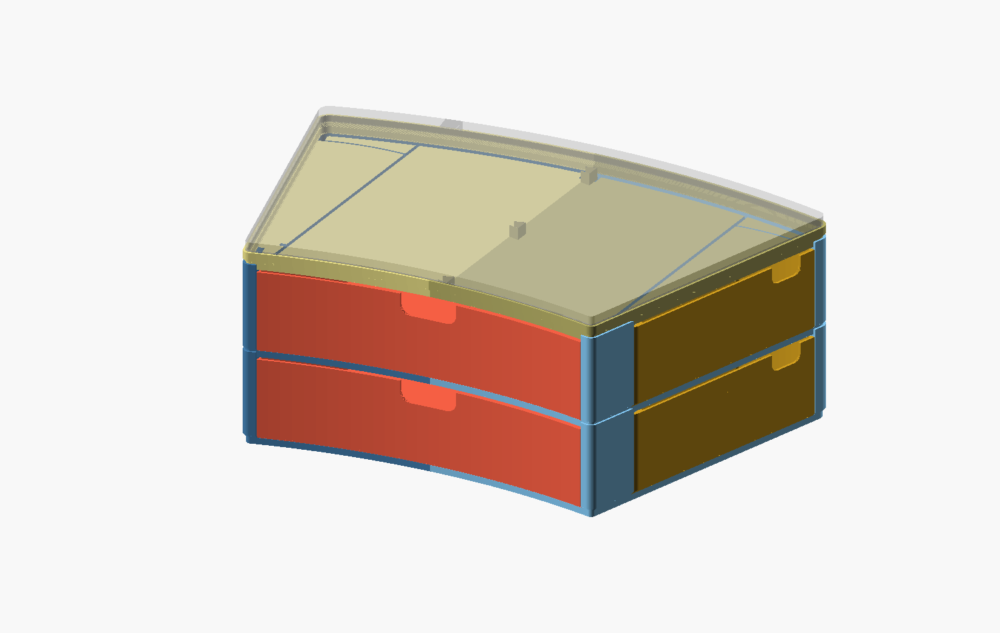
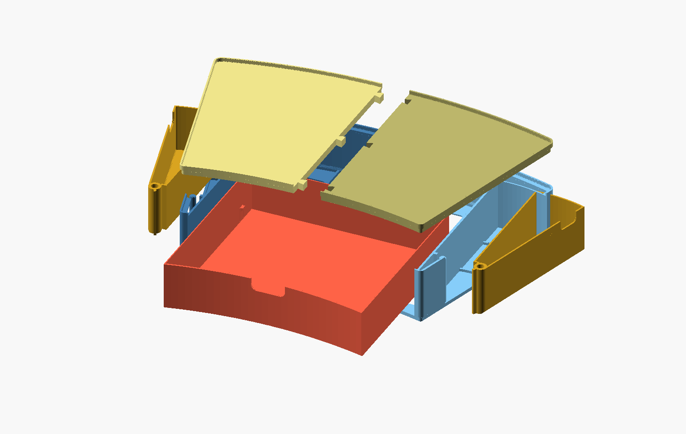
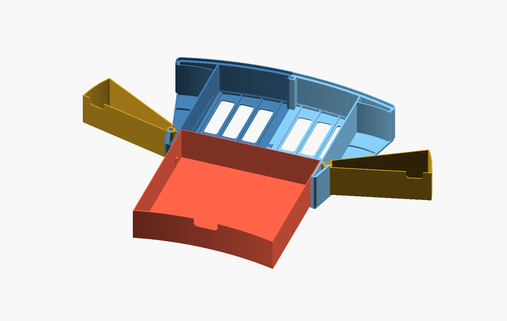

# Riser for the Dell U3421WE

A stackable, 3D-printed riser with the same footprint as the monitor's stand
base, for a Bambu Lab P1S or P1P (256 mm bed). Each module has a main
drawer and two small drawers that swivel out of the side wedges. A top
plate goes between the riser and the monitor.



**Status, 2026-11-13:** designed and checked on the computer, not printed
yet. Five small test pieces come first.

**[DESIGN.md](DESIGN.md) has the measurements, decisions, test history and
next steps.** `../PLAN.md` has the phases, the designer website among them.

## What a module is



| Part | File in `stl/module_60mm/` | PLA | Print time |
|---|---|---|---|
| Body, two halves | `body_left.stl`, `body_right.stl` | 145 g each | 3 h 45 each |
| Main drawer | `drawer_scoop.stl` (or `drawer_plain.stl`) | 136 g | 3 h 03 |
| Wedge drawers | `wedge_swivel_l.stl`, `wedge_swivel_r.stl` | 59 g each | 1 h 40 each |
| Top plate, two halves | `stl/plate_8mm/plate_left.stl`, `plate_right.stl` | 121 g each | 2 h 52 each |

A 60 mm module is 544 g and about 14 hours of printing; an 8 mm top plate
is 241 g and under 6 hours. The numbers are Bambu Studio's, for PLA at
0.20 mm with 3 walls and 15 percent infill.



## Printing

1. **Print the test pieces first** (`stl/tests/`, about 150 g in all). The
   table in `DESIGN.md` section 12 says what each one checks.
2. Print every part as exported: flat on the bed, no supports, 0.20 mm
   layers, 3 walls. One body half per plate, the drawer on its own plate,
   the two wedge drawers together.
3. PLA first. The halves are large flat parts, so watch the corners for
   lifting.

## Putting it together

1. Lay the left body half down and lower the right half onto its
   dovetails.
2. Drop each wedge drawer over its post and swing it shut.
3. Slide the main drawer in until both tongues click into their grooves.
   To take it out again, pull the two finger tabs at the back inward.
4. Press the two halves of the top plate together and set the plate on
   the module, then the monitor on the plate. Modules and plates stack in
   any order.

Once something stands on a module, its wedge drawers cannot be lifted off
their posts.

## Another height

Open `riser.scad`, set `module_h` in the Customizer (30 to 200 mm) and
export the parts, or run the build script, which also checks the result:

```bash
python tools/riser_build.py check
```

```bash
python tools/riser_build.py stl
```

`riser_build.py` needs a current OpenSCAD (2025 or later, for its Manifold
backend). The files still open and preview in OpenSCAD 2021.01; only F6 is
slow there.

## Files

| File | What it is |
|---|---|
| `riser.scad` | The riser: body halves, main drawer, wedge drawers, top plate and the test pieces. Self-contained. |
| `stl/module_60mm/`, `stl/plate_8mm/` | The ready-made set. |
| `stl/tests/` | Test pieces for each new fit. |
| `interface_check.scad` | The Dell base as measured (outline 357.5 x 235 mm overall), the seat on top of the riser that it drops into, and the fit-test ring. Self-contained. |
| `split_concepts.scad` | Rough block models of three ways to split a module into printable parts. Self-contained. |
| `joint_concepts.scad` | Rough samples of five ways to join two parts at a seam. Self-contained. |
| `stl/fit_test_left.stl`, `stl/fit_test_right.stl` | The fit-test ring, ready to slice. |
| `web/` | Meshes and numbers for the designer website. |
| `tools/` | `riser_build.py` checks, exports and slices the riser; the other scripts traced the outline, draw the diagrams and measure the concept parts. |
| `docs/` | Pictures, the dimensioned outline, a 1:1 paper template (two A4 pages, print at 100 %) and the seat's cross-section. |

## Viewing the models

1. Install [OpenSCAD](https://openscad.org/downloads.html).
2. Open a `.scad` file and press **F5** to preview. Drag to rotate, scroll to zoom.
3. Open **Window > Customizer** to change the measurements or switch views
   without editing code.

## Fit-test ring

A thin ring with the same lip the riser will have, for checking the seat
against the real monitor base before anything bigger is printed. About 17 g
of filament per half.

- Print both halves as exported: band flat on the bed, lip up, no supports,
  0.2 mm layers. Each half needs its own plate.
- Press the halves together at the two dovetails, then set the monitor base
  into the ring.
- If the dovetails are too tight or too loose, change `test_joint_gap` in the
  Customizer and re-export.

### Test history

| Ring | Seat | Result |
|---|---|---|
| 1 | Lip 1.2 thick, 3.8 tall, inside face 1.2 inside the plate edge, outside face flush with it | Halves join well, base drops in, edges line up. No side play, and the air gap under the plate looked too big. |
| 2 | Lip 1.8 thick, 4.2 tall, inside face 0.2 inside the plate edge, outside face 1.6 outside it, 0.6 fillets on the inside top edge and foot | Printed on 2026-11-12. Counted as passed by the owner on 2026-11-13, to be checked once more. |
